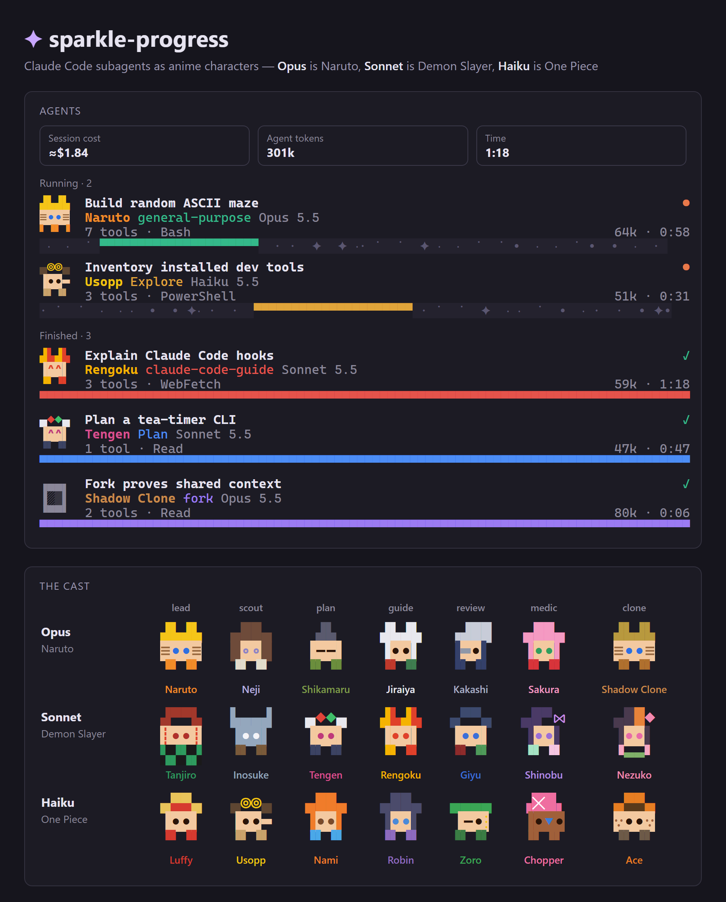

# sparkle-progress



A Claude Code mod that adds some sparkle to long-running work:

- **Sparkly progress pills.** The progress band that `claude-progress` drives (from the Simple Progress Bars plugin) is redrawn as colored pills with a twinkling track, a percent, a hopping pixel mascot and a time-left estimate.
- **An Agents pane.** Each subagent gets a live card with its title, type, model, tool calls, tokens and time. `/sparkle-agents` opens it at any window width. It only opens by itself in a wide window: Claude Code holds back a pane nobody asked for below 144 columns, or below 110 once you've opened it yourself.
- **A character strip above the prompt.** While subagents run, they walk along above the prompt as small characters with their task and time. In a terminal the strip steps aside when the pane is on screen; in the desktop app it always shows.
- **Anime characters by model.** Each card's mascot is an anime character, picked by the agent's model and by what the agent is doing.

## Install

At the prompt of a terminal session:

```
/plugin install sparkle-progress --marketplace gzliang6547/sparkle-anime-agents
```

Answer `y` to add the marketplace, then press Enter for the user scope.

From a shell:

```bash
claude plugin install sparkle-progress --marketplace gzliang6547/sparkle-anime-agents
```

In the Claude desktop app: click **+** next to the prompt box, then **Plugins**, **Add marketplace** with `gzliang6547/sparkle-anime-agents`, then **Add plugin**.

The Agents pane, the strip and their characters work on their own. The progress pills restyle bars that the Simple Progress Bars plugin's `claude-progress` command writes, so they appear only when that plugin is installed too.

## The cast

The model picks the anime: **Opus** is Naruto, **Sonnet** is Demon Slayer, **Haiku** is One Piece. Agents on any other model keep the original pixel critter.

The agent's role picks the character. Built-in agent types set the role directly; any other agent is matched by words in its task title.

| Role | Chosen by | Opus | Sonnet | Haiku |
|---|---|---|---|---|
| Lead | anything else | Naruto | Tanjiro | Luffy |
| Scout | `Explore`, or "search", "find", "scan" | Neji | Inosuke | Usopp |
| Plan | `Plan`, or "plan", "design", "architect" | Shikamaru | Tengen | Nami |
| Guide | `claude-code-guide`, or "explain", "docs", "guide" | Jiraiya | Rengoku | Robin |
| Review | "review", "audit", "verify" | Kakashi | Giyu | Zoro |
| Medic | "debug", "fix", "bug", "test" | Sakura | Shinobu | Chopper |
| Clone | `fork` | Shadow Clone | Nezuko | Ace |

Characters walk while their agent runs, smile when it finishes and get `××` eyes when it fails. The Shadow Clone disappears in a puff of smoke when it's done.

To swap a character or tweak its colors, edit `hooks/anime.ts`. Each character is a few lines: its hair, the cells beside its eyes, its eyes and its legs.

## Developing

Run the mod from a folder with `claude --plugin-dir <folder>`, or name the folder in `CLAUDE_CODE_PLUGIN_DIRS` (in the `env` block of `~/.claude/settings.json`) for sessions the desktop app starts. Check it with `claude plugin validate <folder>`.

## Credits and license

`hooks/bar.ts`, `hooks/parse.ts` and `hooks/watch.ts` are adapted from Simple Progress Bars by Max Hunter, under the MIT license in `LICENSE.simple-progress-bars`. The rest is MIT licensed, see `LICENSE`.

This is an unofficial fan project. It is not affiliated with or endorsed by the creators or rights holders of *Naruto*, *Demon Slayer: Kimetsu no Yaiba* or *One Piece*. Character names belong to their respective owners, and the pixel sprites are original drawings.
